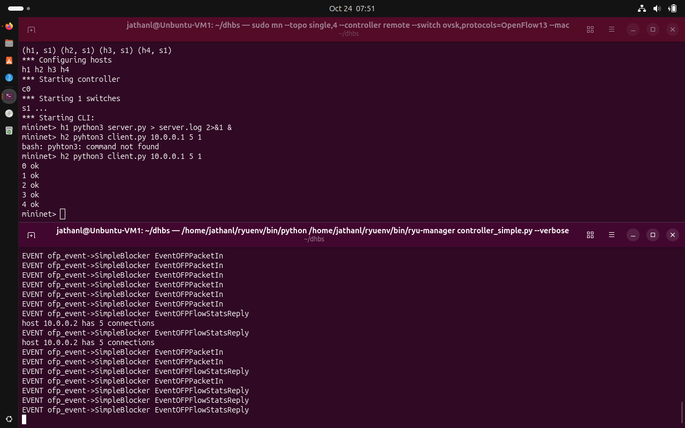
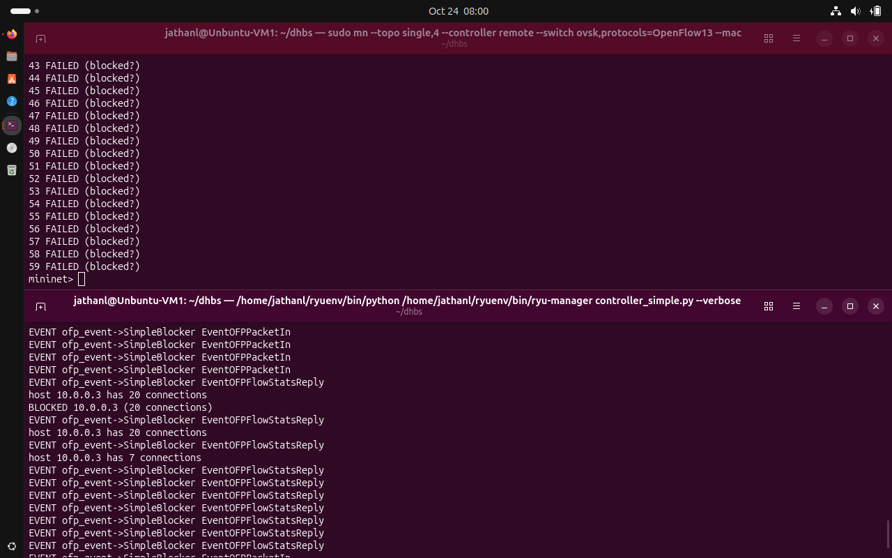
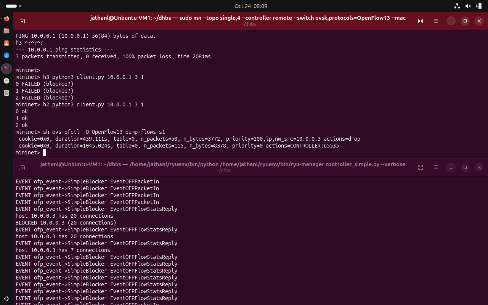
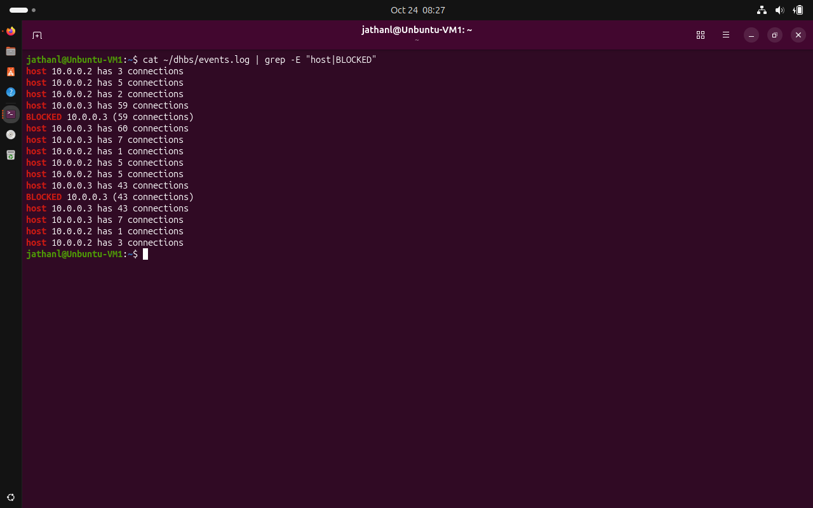
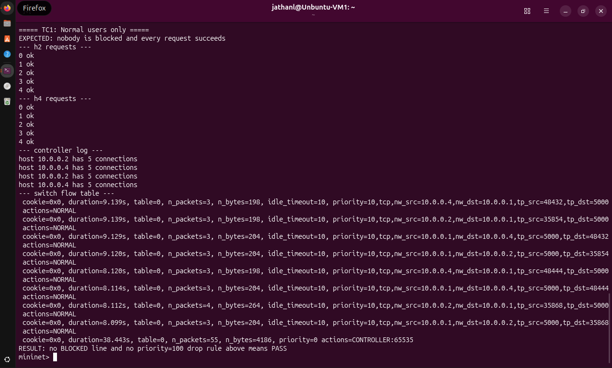
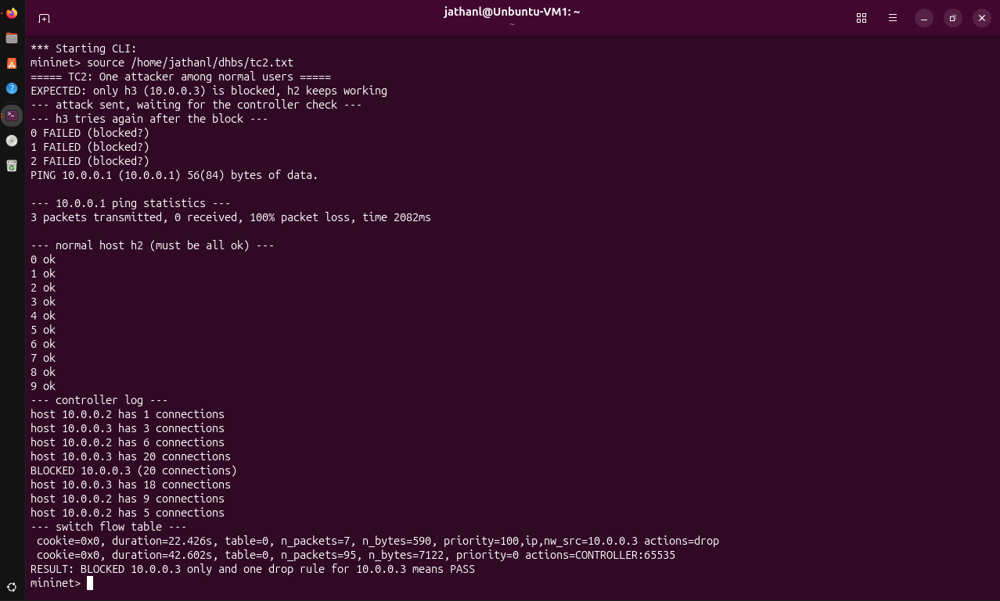
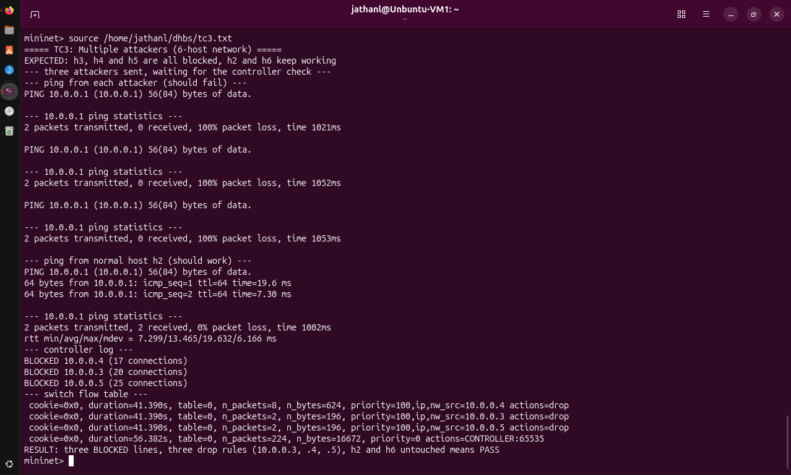
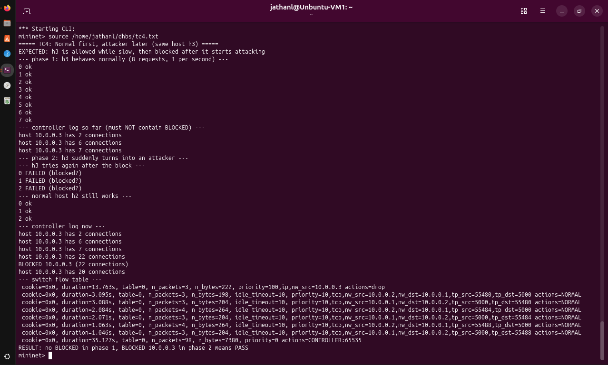
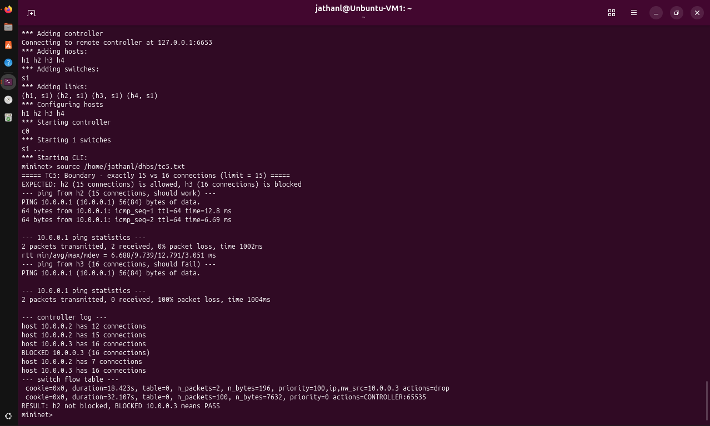
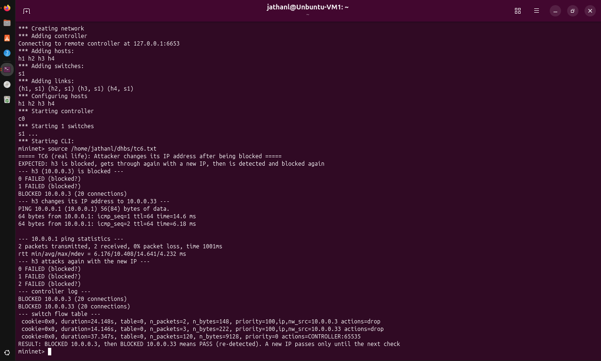

# Dynamic Host Blocking System

A Computer Networks project: detect hosts that open an abnormal number of TCP connections and **block them automatically with SDN flow rules**.

A Ryu (OpenFlow 1.3) controller reads flow statistics from an Open vSwitch switch in Mininet, counts TCP connections per host, and installs a high-priority **drop rule** for any host above the limit. It also drops the host's **MAC address**, so changing the IP address does not help.

## How it works

1. The switch sends the first packet of each new TCP connection to the controller (Packet-In). The controller forwards it and installs one flow rule for that connection (priority 10, idle timeout 10 s).
2. Every **5 seconds** the controller requests flow statistics and counts the rules per source IP going to the protected port (5000).
3. A host with **more than 15** connections is abnormal. The controller adds it to the blocklist, installs drop rules (priority 100) for its **IP** and its **MAC**, and logs `BLOCKED`.
4. Other hosts keep working.

```
        Ryu controller  (control plane: monitor, detect, block)
              |  OpenFlow 1.3
        Open vSwitch s1 (data plane)
        /     |      |      \
   h1 server  h2    h3      h4
              normal attacker normal
```

## Repository layout

| Folder | Contents |
|---|---|
| `sdn/` | Ryu controller, TCP server and client, Mininet start scripts, 7 test-case scripts (`tc1.txt` to `tc7.txt`) |
| `web-demo/` | Live web demo: visitors on any network, a controller dashboard, and 6 automatic test cases |
| `docs/` | Review presentation and screenshots |

## Part 1: Mininet and Ryu demo (real SDN)

**Needs:** Ubuntu 22.04 (or similar), Mininet, Open vSwitch, and Ryu in a Python 3.9 environment (Ryu does not run on very new Python versions).

```bash
sudo apt install -y mininet openvswitch-switch curl
curl -LsSf https://astral.sh/uv/install.sh | sh
source $HOME/.local/bin/env
uv venv --python 3.9 ~/ryuenv && source ~/ryuenv/bin/activate
uv pip install "setuptools<58" wheel pbr eventlet==0.30.2 oslo.config msgpack netaddr ovs routes six webob tinyrpc==1.0.4 "dnspython<2" greenlet packaging
uv pip install --no-build-isolation --no-cache ryu==4.34
ryu-manager --version
```

**Run one test case** (replace `N` with 1 to 7), using two terminal tabs:

```bash
# Tab 1: controller (it stays quiet; leave it running)
bash sdn/ctrl.sh N
# Tab 2: network (start the controller first)
bash sdn/mn.sh N
# then, at the mininet> prompt:
source tcN.txt
```

Each test case runs by itself, prints the expected result, the results, the controller log and the switch flow table. Restart both tabs between tests (a blocked host stays blocked until the controller restarts).

| Test | Scenario | Expected |
|---|---|---|
| TC1 | Normal users only | Nobody blocked |
| TC2 | One attacker among normal users | Only the attacker blocked |
| TC3 | Three attackers (6-host network) | All attackers blocked |
| TC4 | Host behaves normally, then attacks | Allowed first, blocked after it turns bad |
| TC5 | Exactly 15 vs 16 connections | 15 allowed, 16 blocked |
| TC6 | Attacker changes its IP after being blocked | Still blocked (MAC drop rule) |
| TC7 | Distributed attack, each host below the limit | Not detected (known limitation) |

### Results

**First demo run**

| Normal traffic | Attack detected and blocked |
|---|---|
|  |  |

| Drop rule in the flow table | Controller log |
|---|---|
|  |  |

**Test cases** (run with the `tc*.txt` scripts)

| TC1: Normal users only | TC2: One attacker |
|---|---|
|  |  |
| h2 and h4 send 5 requests each, all OK. No BLOCKED line and no drop rule. **PASS** | h3 is blocked at 20 connections and its pings fail. h2 keeps working. One drop rule. **PASS** |

| TC3: Multiple attackers | TC4: Normal first, attacker later |
|---|---|
|  |  |
| h3, h4 and h5 are blocked in the 6-host network. h2 and h6 are untouched. Three drop rules. **PASS** | h3 is allowed for 8 slow requests, then blocked at 22 connections after it turns bad. **PASS** |

| TC5: Boundary 15 vs 16 | TC6: Attacker changes its IP |
|---|---|
|  |  |
| h2 (15 connections) is allowed, h3 (16 connections) is blocked. Ping shows 100% loss. **PASS** | First version (IP rule only): h3 passes briefly as 10.0.0.33, then is blocked at the next check. **PASS** |

> **TC6 note:** the screenshot above was taken before MAC blocking was added. The current controller also drops the attacker's MAC address, so the new IP stays blocked immediately.
>
> **TC7** (distributed attack, known limitation) has no screenshot yet.

## Part 2: Live web demo

A small web server (Python 3, no installs) that shows the same detection logic with real visitors.

```bash
cd web-demo
python web_demo.py
```

* Dashboard (on the host computer only): `http://localhost:8000/dashboard`
* Visitors open the visitor link and press **ENTER**. Slow presses are allowed, very fast presses get **BLOCKED**.
* For friends on other networks, expose the server with a tunnel, for example:
  `ssh -o ServerAliveInterval=60 -R 80:localhost:8000 nokey@localhost.run`
  On Windows, `start_demo.bat` starts the server, the tunnel and the dashboard together.
* The dashboard has **6 automatic test cases** that simulate hosts and show PASS or FAIL, plus a *Device (MAC) blocking* switch.

> The web demo blocks at the web-server level, using each visitor's address and a per-browser device ID. The test-case hosts are simulated. Real packet dropping is shown in Part 1.

## Known limitations and possible improvements

| Limitation | Improvement |
|---|---|
| A fixed limit can block a busy normal user (false positive) | Learn the normal rate, tune the limit, timed unblock |
| Slow attackers stay below the limit | Longer window or cumulative counts |
| Distributed attacks (many hosts, each below the limit) | Add a limit on total connections to the server |
| Only TCP to one port is counted | Count all TCP and use packet counters for UDP/ICMP |
| A host can fake its MAC address | Also block by switch port |
| Blocklist lives in memory and blocks never expire | Save it to a file, add a timeout |

## Team


**Course:** Computer Networks

| Member | 
| Jathan L |
| G Hemanth Reddy | 
| Likhith Chandu Pendyala |
